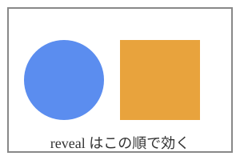

{pause up=part9-title}

{#part9-title}
# 9. メディア

{pause up}

## 動画：ループ再生 vs play-media

繰り返し見せたい動画は `autoplay muted loop` にしておけば、pause を通るたびに勝手に
回り続ける。逆に「このタイミングで 1 回再生」させたいなら `play-media` アクションを使う。

{.remark pause scroll}
**`play-media` は 2 度目が発火しない**（`activate` が実行時に属性を DOM から削除するため）。
複数箇所で同じ動画を自動再生したいなら `autoplay muted loop` にする。

{pause scroll}
```markdown
{pause up=vid play-media=vid}

{video #vid width=30%}
```

{pause up=vid play-media=vid}

{video #vid width=30%}

{.remark pause scroll}
再生できない動画に `play-media` を付けると、ステップ送りが前にも後ろにも進まなくなる
（`about-mp4/parts/05-demos.md` はこれを避けるため、壊れたデモ動画には `controls` を使い、
`play-media` を付けていない）。

{pause up}

## carousel

複数の子要素のうち 1 つだけを表示し、`change-page` で切り替える。PDF の複数ページや、
図の差し替えに向く。

{pause scroll}
```markdown
{carousel change-page=~n:all}
----
ページ 1
---
ページ 2
---
ページ 3
----
```

{pause scroll}
{carousel #demo-carousel change-page=~n:all}
----
{style="font-size:2em; text-align:center"}
ページ 1（クリックで進めるたび次が出る）
---
{style="font-size:2em; text-align:center"}
ページ 2
---
{style="font-size:2em; text-align:center"}
ページ 3
----

{.remark pause scroll}
`~n` は絶対番号（`4`）・相対番号（`+1` `-2`）・範囲（`3-10`）・`all`（1 ページずつ最後まで）を
スペース区切りで並べられる。例：`~n:"2-4 6-4 7 -1 +2 all"`。

{pause up}

## SVG を id で仕込んで部分表示

SVG は Markdown 同様、内側の要素に `id` / `class` を持たせられる。`.unrevealed` を付けておき
`reveal` で 1 つずつ出す。手で編集する場合は SVG ファイルに直接 `id="..." class="unrevealed"`
を書き込む（Inkscape なら「オブジェクトのプロパティ」と「CSS and selectors」から設定できる）。

{pause scroll}
```xml
<circle id="svg-a" class="unrevealed" ... />
<rect   id="svg-b" class="unrevealed" ... />
```

{pause scroll}
{width=50%}

{pause reveal=svg-a}

{pause reveal=svg-b}

{pause reveal=svg-c}

{pause up}

## 描画リプレイ（`.draw`）

編集画面（`R` キー）でペンやハイライターの筆跡を録画し、`.draw` ファイルとして保存できる。
発表中は `draw` アクションで再生する：

```markdown
{#my-drawing}

{draw=my-drawing}
```

このデッキには収録していない（録画データが必要なため）。手順は上流ドキュメントの
`record-and-replay.rst` と `record-tutorial.rst` を参照。

{pause up}
